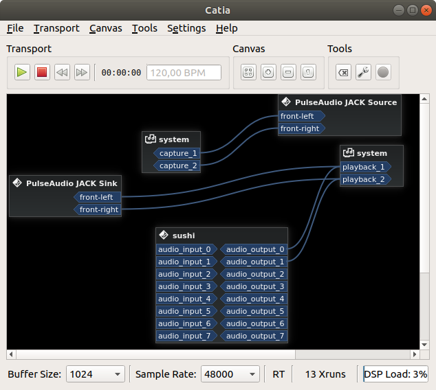

# Running Elk on your computer
In this guide you will quickly see which the first steps are, to run a plugin from within Elk's Sushi host, to get sound playing out of it, and to control its parameters using external control GUIs, such as the Python QT example GUI or Open Sound Control.

**IMPORTANT:** All the below instructions and example files, are written for the context of running on a macOS, Windows or Linux desktop environment, not our development boards, for which the paths, binary files and command line arguments will differ. Refer instead to the [getting started guide for Raspberry Pi](getting_started_with_raspberry.md).

## Running a plugin within the Sushi host

You can run Sushi natively on your own macOS, Windows or Linux computer, or on a Linux virtual machine.

For macOS and Windows we provide binary releases that pack prebuilt Sushi binaries and the MDA plugins suite in VST3 format. The macOS package also includes some example JSON configurations.

1. Download the binary package for your system (*sushi-macos-universal* or *sushi-win-x86*) from the [Sushi's Github releases page](https://github.com/elk-audio/sushi/releases/tag/1.4.0).
2. Unzip the archive wherever you prefer

On Linux you need to build Sushi from source, following the instructions in the *Building* section of the [Sushi README](https://github.com/elk-audio/sushi#building). The build also produces the MDA VST3 plugins used by the example configurations.

All the example configurations are also available under *misc/config_files* in the [Sushi repository](https://github.com/elk-audio/sushi/tree/master/misc/config_files).

### Running Sushi on macOS

If you downloaded the release .zip file from a browser, you'd need to clear the quarantine bit by doing this on the extracted `sushi-1.4.0` folder:
```bash
$ xattr -rc sushi-1.4.0
```

To output sound to your soundcard, you can use the Coreaudio frontend, which will internally use the system's devices. Simply run Sushi with:

```bash
$ ./sushi --coreaudio -c config_files/play_brickworks_synth.json
```

This example is self-contained and should play the bundled simple synthesizer using a short
sequence. By default, this will use the system's default sound device. If you want to specify a different one, you can do that with the `--audio-output-device-uid` flag. You can get a list of devices UID by running `./sushi --coreaudio --dump-audio-devices`.

If you want to test MIDI I/O connection, this example will run another VST3 synthesizer plugin while
listening to MIDI events:
```bash
$ ./sushi --coreaudio -c config_files/play_vst3.json
```

Sushi will connect by default to the first available MIDI input device on the system, if present. If you want to use a different MIDI device, you need to change the `rt_midi_device` field in the Sushi's JSON config file, as explained in the [Sushi's configuration format document](../sushi/sushi_configuration_format.md).

### Running Sushi on Windows

On Windows, Sushi uses the Portaudio frontend to output sound to your soundcard. The Windows package doesn't include the example configurations, so first copy the *misc/config_files* folder from the Sushi repository next to *sushi.exe*. Then, from a terminal in the extracted folder, run:

```bash
$ sushi.exe --portaudio -c config_files/play_brickworks_synth.json
```

You can choose the devices with the `--audio-input-device` and `--audio-output-device` flags. To get a list of the available devices and their ids, run `sushi.exe --portaudio --dump-audio-devices`. LV2 plugins are not supported on Windows.

### Running Sushi on Linux

The preferred way to connect to your soundcard on a Linux computer is through the JACK audio system. You need to have Jack audio configured on your computer, which is beyond the scope of this guide - but if you have trouble getting it working [definitely ask us on the forum](https://forum.elk.audio) and we'll do our best to get you going! We here show how use [Cadence and Catia for managing Jack](https://kx.studio/Repositories#Ubuntu), but you can use any other tools you prefer in their place.

From the root of the Sushi repository, run the binary from your build folder with the JACK frontend:

```bash
$ ./build/apps/sushi -j --connect-ports -c misc/config_files/play_vst3.json
```

The example configuration loads the plugin from a relative path. If Sushi can't find it, use the `--base-plugin-path` flag to point to the folder that contains *mda-vst3.vst3* in your build tree.

You should see the following status message if everything is fine:

```bash
SUSHI - Copyright 2017-2023 Elk Audio AB, Stockholm
SUSHI is licensed under the Affero GPL 3.0. Source code is available at github.com/elk-audio
```

Sushi should also appear as an audio device in your Jack configuration software - see the Catia screenshot below for an example:


​
Note that its outputs are already connected.

That is because the *--connect-ports* command-line option used, attempts to connect the Sushi outputs. If they are
 not connected after running Sushi, you need to make these connections yourself, or you will not be able to hear any sound.

#### Connecting MIDI to Sushi on Linux

Now, although Sushi is successfully running and hosting the MDA jx10 vst3 synthesizer plugin, you will need to
 connect it to a MIDI device to be able to play sound. For this, connect them with the *aconnect* tool:

1. Start a new terminal window than the one where Sushi is running.
2. Type *'aconnect -l'* to list all available MIDI devices and ports for connections:

```bash
client 0: 'System' [type=kernel]
    0 'Timer           '
    1 'Announce        '
client 14: 'Midi Through' [type=kernel]
    0 'Midi Through Port-0'
    1 'Midi Through Port-1'
    2 'Midi Through Port-2'
    3 'Midi Through Port-3'
client 24: 'UA-22' [type=kernel,card=2]
    0 'UA-22 MIDI 1    '
client 28: 'Launchkey MK2 25' [type=kernel,card=3]
    0 'Launchkey MK2 25 MIDI 1'
    1 'Launchkey MK2 25 MIDI 2'
client 128: 'Sushi' [type=user,pid=20167]
    0 'listen:in       '
    1 'write:out       '
```

3. The output you see will vary depending on your configuration, you should take note of the port number X for your MIDI controller (e.g. 28) and the one Y assigned to Sushi, here 128.

4. By typing *aconnect X Y*, or in this example *aconnect 28 128*, you should now hear sound when playing on your
 keyboard.

Tip: If you do not have a physical keyboard available, you can use the ***Virtual MIDI Piano Keyboard*** software (VMPK).

## Where to go from here

If you have now a running Sushi instance on your computer, you're ready to do more complex
operations through the many control options available. We recommend you to check out the following
articles to lear more about it:

  * [Sushi examples overview](../sushi/elk_examples_overview) : see some JSON configuration examples, how to control with the Python
    GUI and through Open Sound Control
  * [Sushi overview](../sushi/sushi_overview) : learn more about Sushi's internal architecture
  * [Control Sushi with gRPC](../sushi/sushi_control_grpc) : if you want to make an application
    that access Sushi's engine in its full power, the best way would be to master its gRPC API

